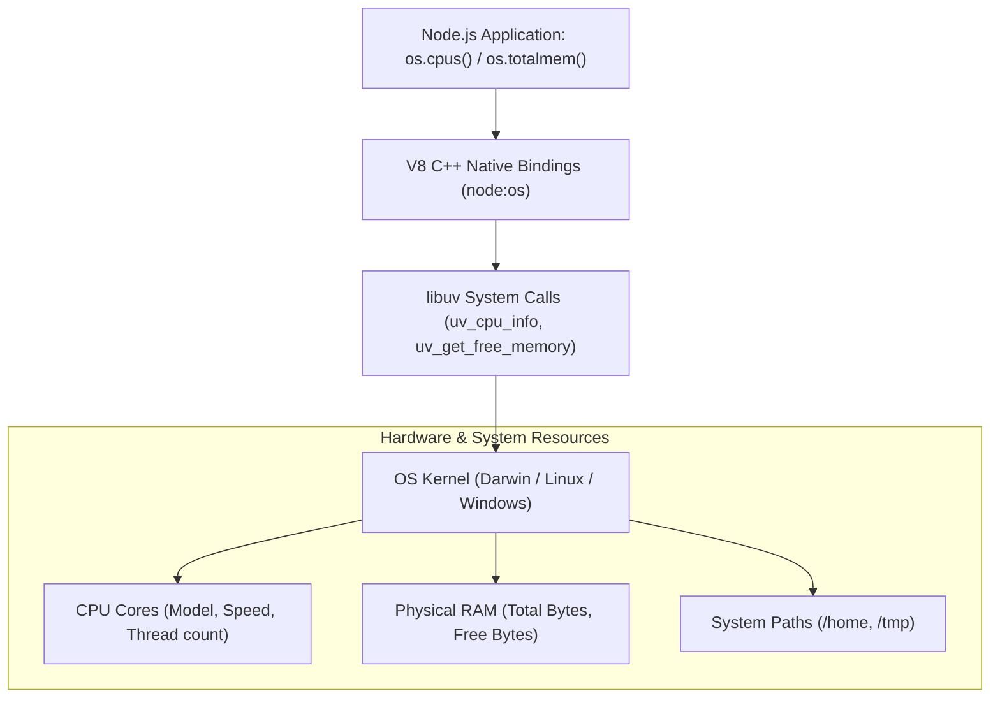

---

## 🗺️ 1. Architecture Flowchart



---

## 📌 2. Cornell Notes Matrix

| 🔑 Cues / Questions | 📝 Notes & Explanations (Notebook-Friendly) |
| :--- | :--- |
| **What is the `os` module?**<br>Do we need npm? | • Built-in Node.js module used to interact with the underlying Operating System and Hardware.<br>• **No npm install needed** — `import os from "node:os"`.<br>• Directly queries OS kernel via libuv system calls. |
| **Why is `os.cpus()` critical for scaling?**<br>*(Top Interview Question)* | • Node.js by default is **Single-Threaded** (runs on 1 CPU core).<br>• If a server has 8 or 16 cores, unused cores remain idle.<br>• In production, `os.cpus().length` is used with the **Cluster module** or **PM2** to spawn matching worker processes (1 worker per core) for **linear throughput scaling**. |
| **RAM Calculations:**<br>Why divide by `1024 ** 3`? | • `os.totalmem()` and `os.freemem()` return values in **raw Bytes**.<br>• $1 \text{ KB} = 1024 \text{ B}$<br>• $1 \text{ MB} = 1024^2 \text{ B}$<br>• $1 \text{ GB} = 1024^3 \text{ B} = 1,073,741,824 \text{ B}$.<br>• Formula: `(os.freemem() / (1024 ** 3)).toFixed(2)` returns RAM in GB. |
| **`os.homedir()` vs `os.tmpdir()`?**<br>Where are they used? | • **`os.homedir()`**: Current user's root directory (`/Users/username` on Mac, `/home/user` on Linux). Used for reading user-level configs (`.aws/credentials`, `.npmrc`).<br>• **`os.tmpdir()`**: OS temporary directory (`/tmp` or `/var/folders/...`). Used for staging file uploads (via Multer) before uploading to Cloudinary/S3. |
| **`os.platform()` vs `os.arch()`?** | • **`os.platform()`**: Operating System identifier (`'darwin'` = Mac, `'linux'`, `'win32'`).<br>• **`os.arch()`**: CPU instruction set (`'arm64'` = Apple Silicon M-series, `'x64'` = Intel/AMD 64-bit). Crucial for Docker container builds. |

---

## 💻 3. Code Cheatsheet

```ts
import os from "node:os";

// 1. Hardware & CPU Cores
const cpuCount = os.cpus().length; // Number of cores for clustering
const cpuModel = os.cpus()[0].model;

// 2. RAM Memory in GB
const totalRamGB = (os.totalmem() / (1024 ** 3)).toFixed(2);
const freeRamGB = (os.freemem() / (1024 ** 3)).toFixed(2);
const usedRamGB = (Number(totalRamGB) - Number(freeRamGB)).toFixed(2);

// 3. Operating System Telemetry
const platform = os.platform(); // 'darwin' | 'linux' | 'win32'
const arch = os.arch();         // 'arm64' | 'x64'
const uptimeHours = (os.uptime() / 3600).toFixed(2);

// 4. Storage Directories
const home = os.homedir();      // User home directory
const temp = os.tmpdir();       // Upload staging directory
```

---

## ⚠️ 4. Key Rules & Common Mistakes

1. **Memory Confusion:** `os.freemem()` tells you **free system RAM on the whole machine**, whereas `process.memoryUsage()` tells you **how much RAM your specific Node.js process is consuming**. Don't mix them up!
2. **Synchronous Execution:** All `os.*` methods are synchronous and return instant cached values from the OS kernel.
3. **Temp File Cleanup:** Files written to `os.tmpdir()` are not automatically deleted immediately by Node.js. Always clean up files after Cloudinary upload.

---

## 🧠 5. Active Recall Questions

1. *Production backend me `os.cpus().length` ka sabse bada use case kya hai?*  
   *(Answer: Node.js clustering / PM2 cluster mode me CPU cores ke barabar worker processes spawn karke multi-core scaling achieve karna).*
2. *`process.memoryUsage()` aur `os.freemem()` me kya antar hai?*  
   *(Answer: `process.memoryUsage()` sirf aapke Node app ki memory batata hai, jabki `os.freemem()` poore computer/server ki available RAM batata hai).*
3. *File upload karte waqt image ko temporary kahan rakha jaata hai?*  
   *(Answer: `os.tmpdir()` me).*

---

## 🎯 6. Summary

> **Summary:**  
> Node.js ka `os` module underlying hardware ka dashboard hai: CPU cores nikaal kar server scale karne (`os.cpus()`), RAM health monitor karne (`os.freemem()`), aur temporary file uploads handle karne (`os.tmpdir()`) ke liye use hota hai.
